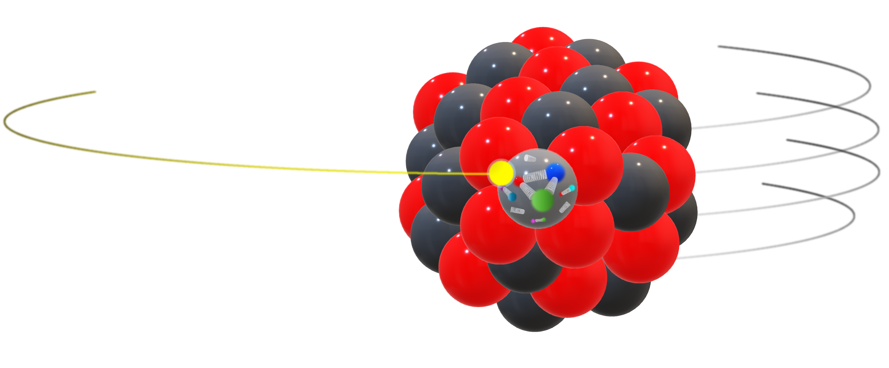

# ELECTRA ⚡️

<p align="center">

</p>

ELECTRA (ELectron-ion Event generation Coupled to TRAnsport) is a simulation
framework for electron-ion collisions. It couples
[eHIJING](https://doi.org/10.1103/PhysRevD.110.034001) event generation to
[SMASH](https://smash-transport.github.io) hadronic transport. For physics details,
please refer to [arXiv:2601:XXXXX](https://www.arxiv.org/abs/2601.XXXXX).

## Overview

This repository provides a framework to simulate electron-ion collision events from the initial hard scattering process through [eHIJING](https://doi.org/10.1103/PhysRevD.110.034001), through the time-dependent hadronization process, and final hadronic transport and decay via [SMASH](https://smash-transport.github.io). The results can be used to predict, compare, and contrast to observations from experiments at the Electron-Ion Collider (EIC).

## Features

- *Event generation with eHIJING:* Medium-modified QCD splitting functions within the higher-twist (HT) and generalized higher-twist (GHT) frameworks are utilized to simulate parton showering in the nuclear medium that takes into account the non-Abelian Landau-Pomeranchuck-Midgal interference effect.
- *Hadronic transport with SMASH:* Hadronic interaction between jet and nucleus are handled utilizing SMASH with custom cross section scaling factors depending on formation time.
- *Modular design:* A flexible pipeline that allows to access intermediate output files.
- *Containerized deployment:* Dependencies, utilities and orchestration scripts are shipped in a Docker/Apptainer container to simplify installation and retain the software environment used for a run.
- *Continous Integration / Continous Delivery (CI/CD):* Container images are built pushed to the registry after every commit, facilitating access to the newest stable version.

## Quick Start

### SLURM cluster execution

1. Download and execute the `install.sh` script:

```terminal
curl -fsSL https://raw.githubusercontent.com/jordissm/electra/main/install.sh -o install.sh \
  && chmod +x install.sh \
  && ./install.sh --pull-sif
```

1. Execute `ehijing` using the SLURM script provided:

```terminal
bash slurm-scripts/ehijing_submit.sh EXPERIMENT=hermes_2007 NUCLEUS=Kr84 NEVENTS=<NEVENTS> CHUNK_SIZE=<CHUNK_SIZE> SEED=12345
```

where `<NEVENTS>` should be an integer between `1` and `1_000_000` and `<CHUNK_SIZE>` should be an integer between `1` and `<NEVENTS>`.

Choose `EXPERIMENT` from `clas`, `hermes_2007`, `hermes_2011`, `hermes_2012`,
`emc_Ebeam-100`, `emc_Ebeam-120`, `emc_Ebeam-200` or `emc_Ebeam-280`.
See [experiment settings](docs/configuration.md#experiment-settings) for beam
energies and DIS cuts. The former `hermes` bundle is now split by year.

1. Prepare the profile index and a compatible SMASH configuration using the
   [local workflow](docs/running/local.md), then select the generated run directory.
   Execute `smash` using the SLURM script provided:

```terminal
bash slurm-scripts/smash_submit.sh RUN_DIR=<RUN_DIR> CONFIG_FILE=<CONFIG_FILE> PROFILES=<PROFILES_INDEX> \
  NEVENTS=<NEVENTS> CHUNK_SIZE=<CHUNK_SIZE> SEED=98765
```

where `<NEVENTS>` need to match the same number used for eHIJING but `<CHUNK_SIZE>` needs not.

### Local execution

1. Download and execute the `install.sh` script:

```terminal
curl -fsSL https://raw.githubusercontent.com/jordissm/electra/main/install.sh -o install.sh \
  && chmod +x install.sh \
  && ./install.sh
```

## Usage

The installer copies packaged utilities into `<prefix>/utils` on both local and
cluster installs. Use `--utils <dir>` to choose another directory. Re-running
the installer adds missing files and preserves existing utility sources.
It also builds the host OSCAR analyzer at `<utils-directory>/analyze_oscar_output`
using CMake and a C++17 compiler. The build script downloads, verifies, and
privately installs yaml-cpp once, then reuses the cached dependency. After editing its sources,
rerun `bash <utils-directory>/build_analysis.sh`; the script locates its sources
independently of the current directory. Use `--skip-analysis-build` on the
installer to defer compilation until the host build tools are available.
For offline installation, set `ELECTRA_YAML_CPP_ARCHIVE` to the official 0.8.0
archive or `ELECTRA_YAML_CPP_PREFIX` to an existing yaml-cpp installation.

`--seed` (or SLURM `SEED`) is an unsigned 64-bit ELECTRA master seed in
`[0, 18446744073709551615]`; zero is reproducible. Defaults are `12345` for
eHIJING and `98765` for SMASH. The `electra-seeds-v1` policy provides replay for
fixed eHIJING chunk starts with identical inputs, build and runtime environment.
Completed tasks validate saved request fingerprints before skipping work.
See the [seed and replay contract](docs/_generated/reproducibility.md) and
[local resume guidance](docs/running/local.md#reproducibility-and-resuming).
Rebuild the bundled modified PYTHIA library/XML settings and eHIJING when
adopting this policy; it changes historical samples, whose original binaries
and records must be retained for replay.

### Documentation

The [Sphinx + MyST manual](docs/index.md) covers installation, local and SLURM
execution, configuration, output formats, physics conventions and analysis.
See [documentation build instructions](docs/README.md) to generate the searchable
HTML manual, including LaTeX equations and optional C++ API references.

For fragmentation plots, see the [spacetime diagram guide](docs/analysis/fragmentation.md).
For identified-hadron spectra before and after transport, see the
[OSCAR analysis guide](docs/analysis/oscar.md).
For configurable event/hadron cuts, species, multidimensional histograms and
profiles, build with `bash utils/build_analysis.sh`, then pass
`--analysis FILE.yaml` to `utils/analyze_oscar_output`.
Start with `analysis/configs/hermes_2007_analysis_input.yaml` or the CLAS,
HERMES 2011/2012 and EMC configurations. See the
[YAML analysis guide](docs/analysis/yaml-oscar.md) for the schema and SLURM usage.

For HERMES cross-section profile comparisons, run
`bash analysis/run_HERMES_cross_section_profile_comparison_plot_scripts_e_d.sh` or
`bash analysis/run_HERMES_cross_section_profile_comparison_plot_scripts_R_A.sh`.
These read `profile_XXXXXX.yoda` files under
`analysis/output/data/HERMES/cross_section_profile_comparison/R_A/d/` and
`analysis/output/data/HERMES/cross_section_profile_comparison/R_A/{d,He,Ne,Kr,Xe}/`,
respectively. Figures are saved under
`analysis/output/plots/HERMES/cross_section_profile_comparison/R_A/`.
The R_A plots match each deuterium profile to the same filename
for each nucleus. Empty deuterium/e+d files are skipped with a warning.
Legends show profile IDs; no formation time is inferred from an ID.
The e+d Python scripts accept `--profile-files FILE [FILE ...]`, with
`--tau-files` retained as an alias for older callers. To select R_A profiles
or customize their labels, replace `profile_directory` in
`analysis/scripts/HERMES/cross_section_profile_comparison/R_A/RA_vs_zh_inputs.yaml` with an
explicit `scenarios` list containing `label`, `deuterium`, and `nuclei`
entries, as used by the model-comparison configuration.

Run all experiment/comparison plotting workflows with
`bash analysis/run_all_plot_scripts.sh`. Add `--dry-run` to inspect the commands
or `--clas-data-only` to omit CLAS simulation overlays. The runner continues
after failures and reports them at the end. Configuration options are described
in the [plotting script guide](analysis/scripts/README.md).

For CLAS or EMC model comparisons alone, run
`bash analysis/run_CLAS_model_comparison_plot_scripts_R_A.sh` or
`bash analysis/run_EMC_model_comparison_plot_scripts_R_A.sh`. Each uses its own
config under `analysis/scripts/<EXPERIMENT>/model_comparison/R_A/`, reads inputs
from `analysis/output/data/<EXPERIMENT>/model_comparison/R_A/`, and writes
figures under `analysis/output/plots/<EXPERIMENT>/model_comparison/R_A/`.

Plotting scripts are grouped by experiment under `analysis/scripts/HERMES/`
and `analysis/scripts/CLAS/`; comparisons across experiments live under
`analysis/scripts/experiment_comparison/`. See the
[plotting script guide](analysis/scripts/README.md) for the directory map.
For the CLAS charged-pion ratios in Fig. 1 of arXiv:2109.09951, run
`bash analysis/run_CLAS_cross_section_profile_comparison_plot_scripts_R_A.sh`.
This plots the published Table II data with the HERMES panel/error-box style;
the same launcher also writes separate pi+ and pi- figures binned in Q2 and nu
for Figs. 2–3 using Tables III–VIII. Pass `--config` to overlay CLAS
cross-section profiles as described in the guide.

The EMC charged-hadron comparison (EMC Fig. 4 / eHIJING Fig. 18) is available
through `analysis/run_EMC_cross_section_profile_comparison_plot_scripts_R_A.sh`
and is included in the all-plots runner. It awaits the original experimental
table in `analysis/experimental_data/EMC/R_A/Fig4.csv`; the plotting guide
documents its CSV schema and optional simulation inputs. EMC scripts live
under `analysis/scripts/EMC/`.

For pooled charged-hadron mean production and formation times versus `z_h`,
run the C++ `utils/analyze_oscar_output.cpp` analyzer on the data host, directly
or through the SLURM analysis wrapper. In legacy mode, every run applies the HERMES selections
and writes native YODA time profiles alongside all multiplicity histograms.
`analysis/run_hadronization_comparison_times_vs_zh.sh` reads only those
YODA files and compares HERMES, EMC, and CLAS locally as PDF/PNG, independently
of target species. Its time profiles currently share the HERMES selections;
experimental setup labels do not change the cuts applied during processing.
See the [time analysis guide](docs/analysis/times-vs-zh.md) for configuration
and input requirements.

## Citation

If you use ELECTRA in your research, please cite:

```bibtex
@article{salinassanmartin2026electra,
    title={},
    author={},
    journal={},
    volume={},
    pages={},
    year={2025}
}
```

## License

ELECTRA is released under the UIUC License. See [LICENSE](LICENSE) for details.

## Attribution

This project is the collaboration of J. Salinas San Martin, W. Zhao, W. Ke, J. Noronha-Hostler, and X.-N. Yang.

## Acknowledgements

This work has been supported by the Saturated Glue (SURGE) Topical Theory Collaboration.
